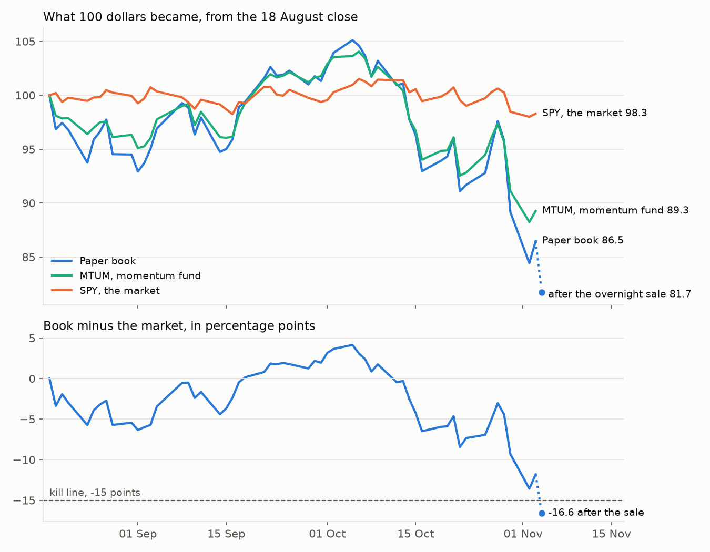

# Stock book trial

Written 4 November 2026, at the operator's word "yes write up the trial". The trial ran on the Alpaca paper account from 18 August to 3 November 2026. Every figure was recomputed at 16:00 New York on 4 November by `03-inputs/trial_review.py`, whose outputs sit beside this file.

## Where the money actually is

| | |
| --- | --- |
| Account value | $81,703.14, all cash, from a $100,000 start |
| Change since it went live on 18 August | -18.30% after the overnight sale. At the 3 November close it was -13.52% |
| The market, same period | -1.71%, SPY from the 18 August close to the 3 November close |
| Was this within expectations? | No. Only 2.0% of 54-session stretches in the replay of the same rule since 2017 trailed the market this far |
| Worst single holding | None now. Over the trial AAOI lost most, $1,208, across three purchases, two of them ended by the 25% stop |
| What it costs us to trade | 10.6 basis points a fill on average and 5.1 for the typical fill, on 294 fills, against the 5 to 10 we assumed. The 42 fills after the 26 October changes averaged 5.6. The overnight sale is reported separately |
| Rebalances done | 11 of the 6 the trial needed. 4 ran late and the week of 28 September was missed, the longest gap 13 days against 7 |

**This is fake money.** It is a paper account. The switch that would let it spend real money is off.

## The answer

The book lost 18.30 per cent in 55 sessions while the market lost 1.71, so it finished 16.59 points behind. The plan of 19 October said the book stops at 15 points behind and the trial is written up as a failure. By that rule the trial failed.

The operator stopped the book on the evening of 3 November, before any closing reading had crossed the line. The worst close was 13.57 points behind, on 2 November. The book went past the line in the overnight sale, which raised 4,778 dollars less than the shares were worth at that day's close.

The trial does not show that 12-1 momentum has no edge. Of the 16.59 points, 9.03 belonged to momentum itself, which MTUM, a public momentum fund, lost over the same days. Fifty-five sessions are also far too few to tell an edge of about one point a month from luck.

The sections below give the design, the weekly readings, where the money went, what trading cost, how the trial ended, how rare the result was, and what it showed.

## The design

The book held 50 US stocks chosen by 12-1 momentum, each stock's return over the past twelve months leaving out the latest month. It rebalanced weekly and never shorted or borrowed. Each name was bought at 1.8 per cent of the account, raised to 1.96 when the cash floor fell from 10 to 2 per cent on 20 October.

The rule was the only one in this project to pass its kill tests. The portfolio simulation of 18 August gave 30.5 per cent a year against 17.5 for SPY, after 5 basis points of cost a round trip. Its volatility was 35.1 per cent a year. Its worst month was -27.8 per cent, July 2026, and its Sharpe ratio, return per unit of risk, was 0.93 against 1.02 for SPY (record `04-outputs/AA-evals/2026-08-18/portfolio-sim-20260818.md`).

The rules changed during the trial. Funds left the list of stocks and a cap on closely moving groups came in on 25 August. The drawdown ramp and the trimming of winners followed on 19 and 20 October, each after passing a test with its pass mark fixed in advance. The 2 per cent cash floor failed its test and was set by the operator's override on 20 October. Limit orders first began on 26 October, and the kill line was the operator's order of 3 November. A 25 per cent stop on any single holding ran throughout.

## Weekly readings

Table 1. Change since the 18 August close at each Friday's close, from the broker's 16:00 record. The book is measured from its $100,000 start.

| Friday | Book | SPY | MTUM | Book minus SPY, points |
| --- | ---: | ---: | ---: | ---: |
| 21 August | -3.23% | -0.23% | -2.13% | -3.00 |
| 28 August | -5.47% | +0.25% | -3.88% | -5.71 |
| 4 September | -3.08% | +0.36% | -2.23% | -3.44 |
| 11 September | -2.07% | -0.41% | -1.53% | -1.66 |
| 18 September | -0.59% | -0.75% | -0.70% | +0.16 |
| 25 September | +2.29% | +0.51% | +2.15% | +1.78 |
| 2 October | +3.94% | +0.29% | +3.55% | +3.66 |
| 9 October | +3.20% | +1.45% | +2.63% | +1.75 |
| 16 October | -7.04% | -0.55% | -5.98% | -6.49 |
| 23 October | -8.31% | -0.97% | -7.17% | -7.33 |
| 30 October | -10.85% | -1.53% | -8.89% | -9.33 |
| 3 November, close | -13.52% | -1.71% | -10.74% | -11.81 |
| 3 November, after the sale | -18.30% | -1.71% | -10.74% | -16.59 |

These are closing figures, so they differ by up to 0.9 points from the daily reports, which were read at other times of day.

The book trailed for its first four weeks, drew level on 18 September and led the market by 4.15 points at its peak of 105,111 dollars on 5 October. It then lost in three steps. In the week to 16 October it fell 9.92 per cent against 1.97 for SPY. On 22 October, 30 October and 2 November it fell 5.20, 6.97 and 5.29 per cent in single sessions. From the peak to the 2 November close it fell 19.68 per cent.

Figure 1. Top, what 100 dollars became in the book, MTUM and SPY from the 18 August close, with the book after the overnight sale. Bottom, the book minus SPY in percentage points, against the kill line at -15.

## Where it went

The gap split into two parts. MTUM, a public fund that buys past winners as the book did, fell 10.74 per cent, 9.03 points behind SPY. That part belonged to momentum as a style in these weeks. The other 7.56 points belonged to this version of it.

At the 3 November close the version's share was only 2.78 points. The other 4.78 came from the overnight sale that night.

The book behaved as a sharper copy of the fund. Its daily moves had a correlation of 0.96 with MTUM's, and on average it moved 1.42 per cent for each 1 per cent the fund moved. Its volatility was 35.5 per cent a year, against 35.1 in the simulation, 24.0 for MTUM and 10.2 for SPY. The book took the risk the simulation said it would, and the market went against it.

Over the trial 111 stocks were held at some point and 346 orders filled. Of those names, 84 lost money and 27 made money. Their dollars sum to the account's change to within 7 cents, after 9.36 dollars of dividends and 3.51 of fees.

The ten worst lost 8,235 dollars together (Table 2). Nine made chips, chip wafers, optical parts, chip test equipment or disk drives, and the tenth sold cloud hosting. The ten best made 2,913 dollars, led by Moderna (MRNA) at 792 and Palo Alto Networks (PANW) at 458.

Table 2. The ten names that lost the most over the trial, with what each company makes.

| Name | What it makes | Dollars |
| --- | --- | ---: |
| AAOI | optical parts | -1,208 |
| AXTI | wafers for chips | -1,163 |
| SITM | timing chips | -897 |
| SMTC | chips | -735 |
| STX | disk drives | -727 |
| DOCN | cloud hosting | -726 |
| INTC | chips | -718 |
| TSEM | contract chipmaking | -708 |
| COHR | lasers and optical parts | -691 |
| TER | chip test equipment | -662 |

The 25 per cent stop sold 16 holdings across 14 names. AXTI and AAOI were each stopped twice, because the weekly rebalance bought them back while they still ranked in the top tenth. On 14 September AAOI was bought back 36 minutes after its first stop. A replay from 2017 found the stop made little difference, 27.8 per cent a year with it against 28.2 without (record `04-outputs/AA-evals/2026-10-22/risk-rules-catstop-20261022-115526.md`).

The first week ran under older rules, with funds in the list and no cap on closely moving groups. A replay of that week put their cost at 2.82 points (record `04-outputs/AA-evals/2026-10-22/gap-attribution-20261022-120439.md`).

## Trading cost

Every regular-session fill was compared with the volume-weighted average price of the minute it filled in. Over 294 fills the mean cost was 10.6 basis points, hundredths of a per cent, and the typical fill cost 5.1. That came to 514 dollars on 452,220 dollars traded, against the 5 to 10 basis points assumed.

Most of the excess came before 26 October, when 252 fills averaged 11.5. From 26 October the rebalance waited 90 minutes after the open and tried limit orders on every other name. The 42 fills after that averaged 5.6 basis points, inside the assumption. Trading cost came to 2.8 per cent of the trial's loss.

## How it ended

At the 3 November close the account stood at 86,481 dollars, 11.81 points behind the market and 3.19 from the line. That evening the operator first ordered a sale at the next morning's open, and at 22:58 New York the book queued 50 market sell orders. At 23:05 the operator said to sell at once.

All 50 holdings could trade in the broker's overnight session, which runs from 20:00 to 04:00 New York. The queued orders were replaced by overnight limit sells, and all 50 filled between 23:07 and 23:13. Few buyers trade at that hour. Only 9 of the 50 sold within 3 per cent of their closing price, and TWST sold 12.3 per cent under it.

The sale raised 79,125 dollars. The same shares were worth 83,904 dollars at the 3 November close and 82,725 at the 4 November open. Selling overnight therefore cost 4,778 dollars against that close and 3,600 against waiting for the open. By about 15:40 New York on 4 November the shares had fallen to 80,936 dollars.

The sale left 81,703.14 dollars in cash. The book is stopped. The rebalance, the top-up and the scheduled tick all refuse to buy while the broker holds orders tagged `kill-`, and a restart is the operator's decision.

## How rare

The same rule was replayed from January 2017 to 19 October 2026, with equal weights reset weekly, no cost, and only stocks still listed today, which flatters it (record `04-outputs/AA-evals/2026-10-19/momentum-check-20261019-222230.md`). Across 2,399 overlapping stretches of 54 sessions, the replay beat SPY by 3.3 points on average, with a standard deviation of 9.6 points.

Stretches trailing SPY by 11.81 points or more made up 4.1 per cent of the total. Those trailing by 16.59 or more made up 2.0 per cent, and a fall of 18.30 per cent or worse 1.9 per cent. Stretches past the 15 point line fell in four spells, spring 2021, January 2022, the turn of 2026, and late July to mid-September 2026. The worst ended on 29 July 2026, 28.9 points behind, three weeks before the trial began.

The trial therefore drew a stretch of about one in 25 at the close and one in 50 after the sale. Such stretches were rare in the replay, though two of the four spells fell within the year before the trial began.

## What it showed

The trial could not test whether momentum works. At the replay's own average of 3.3 points and spread of 9.6, telling an edge from luck at two standard errors takes about 34 separate 54-session stretches. That is roughly seven years, so a three-month trial measures cost and running, not edge.

Of what it did measure, two parts held up. Cost after the 26 October changes was 5.6 basis points, inside the assumption, and the book's volatility matched the simulation at 35.5 per cent a year against 35.1. The running did not hold up. Four of ten gaps between rebalances ran past seven days. The scheduler stopped for twelve days from 27 August, and a step that never finished froze it again in late September.

The loss itself was mostly momentum's. MTUM's own fall accounted for 9.03 of the 16.59 points, and the book moved 1.42 times as far as the fund. Until the last evening this version trailed the fund by only 2.78 points. Its holdings leaned on chip, optical and storage makers, which supplied nine of the ten worst names.

The overnight sale of these 50 stocks cost 4.4 per cent against the next open and 5.7 per cent against the last close. That one sale took the book from 11.81 to 16.59 points behind.

## Next decisions

The stock book is the operator's to restart or close, and three courses are open. It can restart as it ran, to be judged at one year and by the same kill line. It can restart under a changed rule, which would first need a test with its pass mark fixed in advance, as the ramp and the trim had. Or the stock track can close and the account stay in cash.

A restart needs one code change, because the stop is read from the broker's `kill-` orders and those stay on record. Real money remains off, and only the operator can switch it on.

On 5 November 2026 the operator chose the third course, in the words "yes close it". The stock track closed and the account stayed in cash. It held 81,701.50 dollars, after 1.64 dollars of regulatory fees on the overnight sale posted on 4 November.

## Figure sources

`03-inputs/trial_review.py` wrote `trial-review-numbers.json`, the four CSV files and `trial-review.png` in this folder. The account, every fill and the closing equity came from the Alpaca paper broker, whose 16:00 record and `last_equity` agree. SPY, MTUM and the stocks' prices came from Alpaca's consolidated SIP feed. The replay came from the momentum check of 19 October.
